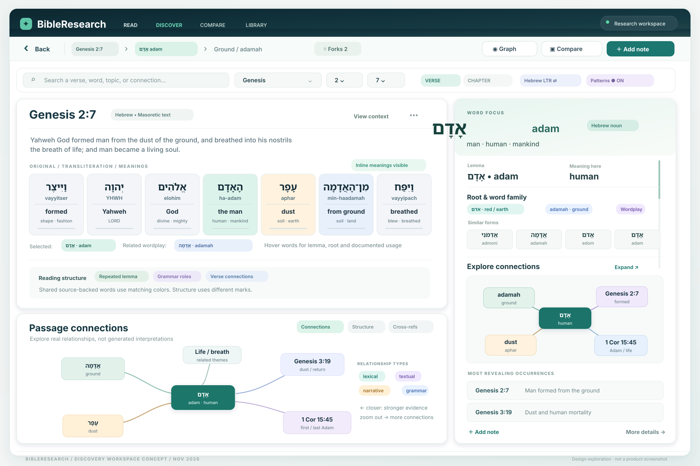

# BibleResearch — Modern Discovery Workspace concept

**[Open the full-size modern UI concept](MODERN_DISCOVERY_CONCEPT.svg)**

This **single modern vector concept** replaces the five older experimental SVG layouts. It is an **illustrative design**, not a screenshot or a final approved interface.

The current approved source of functional UX requirements is the repository-root [UX_STRATEGY.md](../../../UX_STRATEGY.md), updated November 22, 2026. Implementation orchestration is provided directly in the current user-approved chat prompt; there is no separate GitHub orchestrator prompt.

## What this concept explores

- Bible-first, spacious reading with the complete English WEB verse as a smaller heading and a visually dominant Hebrew interlinear flow, showing original script, transliteration, observed English and alternative sourced meanings.
- A **fixed top research trail**, easy back/fork actions, search and verse/chapter selectors, and optional Hebrew LTR/RTL tile flow.
- A contextual **Word Focus inspector** with lemma, senses, documented roots and spelling relatives, a compact relationship graph, and meaningful occurrences.
- A **large passage relationship graph below the reader**, with distinguishable relation types and more/less important connections visible through zoom and exploration.
- A modern visual language: restrained white/cream backgrounds, deep teal navigation, soft green/blue/lilac/gold evidence accents, large readable text and low-clutter controls.

**No visual design is yet approved.** Neon should not blindly copy this illustration or use it instead of the user's live choices. User feedback while working in `npm run dev` is authoritative. All shown text, graph links and labels are illustrative; source evidence must be verified from the actual project.

**Current resource:** [MODERN_DISCOVERY_CONCEPT.svg](MODERN_DISCOVERY_CONCEPT.svg).